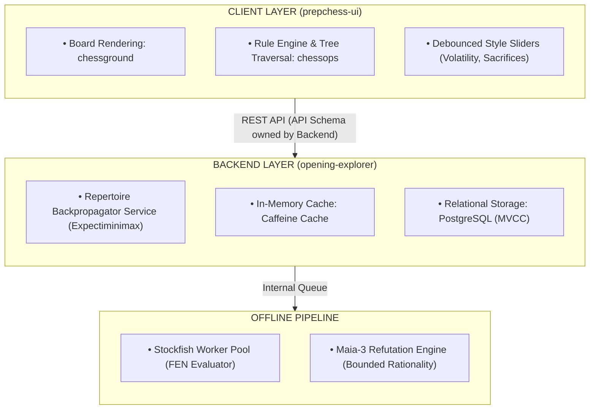

# Master System Architecture

## 1. Core Philosophy

**PrepChess (ChessGamma)** is an adaptive, algorithmic chess opening repertoire generator and interactive study platform. Traditional engines rely on standard Minimax search to identify the "objectively best" move, assuming perfect play. This produces "tightrope" lines—positions where a single human inaccuracy leads to immediate collapse.

PrepChess introduces the **"Practical Human Eval"** framework:
1. **Minefields vs. Tightropes:** Identifies lines where human opponents are statistically prone to errors.
2. **Multi-Objective Utility:** Instead of pure centipawn scores, candidate branches are evaluated using a custom utility function combining mean evaluation, volatility ($\sigma$), and sacrifice metrics.
3. **Hollow Frontend Security:** All proprietary math executes strictly on the backend.

## 2. Component Responsibilities

## 3. Database Schema Overview

Currently implemented using an **H2 Database** (file-based) coupled with a robust `BuildCheckpointService` for session resumption and async state persistence.

* **Session Entities:** `BuildSessionEntity` tracks the lifecycle of an `IN_PROGRESS` repertoire run.
* **Checkpointing Cache:** `ExploredFenEntity` and `EvaluatedFenEntity` track completed subtrees and FEN evaluations to allow instant O(1) skips across restarts.
* **O(N) Reconstruction:** Uses a single-pass `HashMap<Long, RepertoireNode>` to connect parents to children during rendering.
* **Future Scaling:** Migration to PostgreSQL (MVCC, `reWriteBatchedInserts=true`) is planned for MVP 2 to support multi-user concurrent generation.
