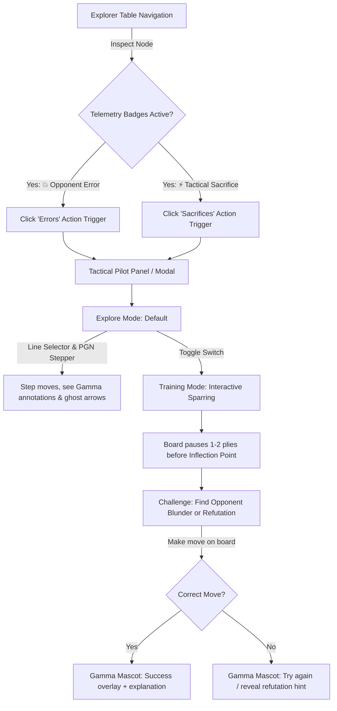

# SPEC-04: MVP 1.5 Interactive Tactical Pilot (Errors & Sacrifices)

> **Status:** Specification (Active Target: MVP 1.5)  
> **Milestone:** MVP 1.5 — The Interactive Pilot  
> **Target Components:** `prepchess-ui` (React 19 / TypeScript) & `opening-explorer` (Java 21 / Spring Boot)

---

## 1. Objective & Commercial Rationale

The goal of MVP 1.5 is to deliver an end-to-end playable vertical slice on curated, high-asymmetry example repertoires (e.g., Vienna Gambit, Smith-Morra, Fried Liver, Traxler Counter-Attack).

Instead of presenting users with a cold table of engine numbers, this feature exposes **Psychological Asymmetry** directly to early testers, chess coaches, and beta users:
1. Proves why human opponents collapse in specific tactical minefields despite Stockfish displaying `+0.00` or `-0.20`.
2. Provides an interactive feedback loop (**Explore Mode** vs. **Training Mode**) so coaches and players can drill finding common human blunders and tactical refutations with "no drama."

---

## 2. Feature Architecture & User Journey



---

## 3. Frontend Specification (`prepchess-ui`)

### 3.1 Explorer Table Telemetry & Visual Badges
In the candidate move list (`ExplorerTable.tsx` / `TableRow.tsx`):
- **Opponent Error Badge (💥 or ⚠️):** Displayed next to an opponent candidate move when the node represents a high-frequency human blunder (eval drops sharply for them, popularity remains high).
- **Tactical Sacrifice Badge (⚡ or 🚨):** Displayed next to a player move when material is temporarily sacrificed for initiative, dynamic compensation, or a forced blunder trap.
- **Contextual Action Toolbar:**
  - When the current position has blunder or sacrifice lines available in the repertoire tree, display two glowing action chips/buttons:
    - `[💥 Common Errors (N)]`
    - `[⚡ Tactical Sacrifices (N)]`

### 3.2 Tactical Pilot View (The "Trap Lab" Slice)
Clicking either action chip opens the **Tactical View** (integrated side panel or modal overlay above the explorer):

#### A. Mode 1: Explore Mode (Default)
- **Line Navigator:** Displays a list of extracted tactical lines for this position (e.g. *"Line 1: 4...Nf6?? 5. Ng5 (68% frequency)"*).
- **Interactive Move Stepper:**
  - Stepping through the line updates the chessboard.
  - Highlights the blunder move with a distinct warning arrow/square color.
  - Highlights the refutation move with a cyan tactical arrow.
- **Gamma Mascot Co-Pilot Card:**
  - Displays short, clear psychological commentary explaining why humans make this mistake (e.g., *"Natural developing move, but fails tactically to the unprotected d5 square"*).

#### B. Mode 2: Training Mode (Interactive Sparring)
- **Sparring State:**
  - Board automatically sets the position 1–2 plies *before* the critical inflection point.
  - The board locks into interactive puzzle mode.
- **The Prompt:**
  - *"Guess Black's most common blunder here"* OR *"Find White's tactical punishment"*.
- **Move Validation:**
  - User plays a move directly on the `chessground` board.
  - Validated using `chessops` against the target line's critical move.
- **Feedback Loop (Gamma Bot):**
  - **Success:** *"Exact refutation. This wins material in 74% of games."*
  - **Mistake:** *"Logical, but gives Black time to castle. Try finding the queen invasion."* (Option to retry or show solution).

---

## 4. Backend API Contract (`opening-explorer`)

The backend already has foundational infrastructure in `ExampleLinesController.java` (`/api/repertoire/example-lines`) and `ExampleLineExtractionService.java`.

### 4.1 Endpoint Schema
`GET /api/repertoire/example-lines`

**Headers:**
- `X-Session-ID: <UUID>`

**Query Parameters:**
- `fen: <string>` (Target position FEN)
- `category: <string>` (`BASIC_ERRORS` | `SACRIFICES` | `TRAPS`)
- `percentile: <int>` (Default: `100`)
- `page: <int>` (Default: `0`)
- `size: <int>` (Default: `10`)

**Response Payload (`ExampleLinesListRespDTO`):**
```json
{
  "startFen": "r1bqk1nr/pppp1ppp/2n5/2b1p3/2B1P3/5N2/PPPP1PPP/RNBQK2R w KQkq - 4 4",
  "category": "BASIC_ERRORS",
  "metadata": [
    { "name": "lossScore", "type": "FLOAT", "label": "Evaluation Drop" },
    { "name": "blunderMove", "type": "STRING", "label": "Blunder Move" },
    { "name": "blunderProb", "type": "PERCENT", "label": "Human Frequency" },
    { "name": "punishmentMove", "type": "STRING", "label": "Refutation Move" }
  ],
  "lines": [
    {
      "pgn": "1. e4 e5 2. Nf3 Nc6 3. Bc4 Bc5 4. c3 Nf6 5. d4 exd4 6. cxd4 Bb4+ 7. Bd2 Nxe4 8. Bxb4 Nxb4 9. Bxf7+ Kxf7 10. Qb3+",
      "attributes": {
        "lossScore": -2.85,
        "blunderPly": 13,
        "blunderSan": "Nxe4",
        "blunderUci": "f6e4",
        "blunderProb": 0.42,
        "punishmentSan": "Bxf7+",
        "punishmentUci": "c4f7",
        "annotation": "Greedy pawn grab opens the f7 vulnerability."
      }
    }
  ],
  "totalElements": 3,
  "totalPages": 1,
  "currentPage": 0
}
```

---

## 5. Scope & Guardrails (Non-Goals for MVP 1.5)

* **No Billing / Stripe:** Testing is restricted to local curated repertoires or unlocked beta sessions.
* **No User Game Synchronization:** Does not require syncing Chess.com / Lichess OAuth accounts yet (that is MVP 2).
* **Strict "Hollow Frontend":** The UI never calculates blunders or refutations locally; it simply consumes the lines and attributes returned by `/api/repertoire/example-lines`.
* **Zero Disruption to Main Repertoire Tree:** The tactical pilot builds on top of the existing `useExplorerStore` history and `BoardContainer` wrapper.

---

## 6. Implementation Deliverables

1. **Backend Verification:**
   - Verify `ExampleLinesController` returns correct `ExampleLinesListRespDTO` for sample repertoires.
   - Add/verify strategy for `SACRIFICES` in `ExampleLineExtractionService`.
2. **Frontend UI Components (`prepchess-ui`):**
   - Badges in `TableRow.tsx` (💥 and ⚡).
   - `TacticalPilotPanel.tsx` (toggle between Explore and Training Mode).
   - Sparring interaction hook / state in `useExplorerStore.ts`.
3. **Automated Verification:**
   - Vitest unit tests for tactical line parsing.
   - Playwright E2E test verifying: opening the Tactical View $\to$ playing the challenge move $\to$ viewing Gamma's feedback.
