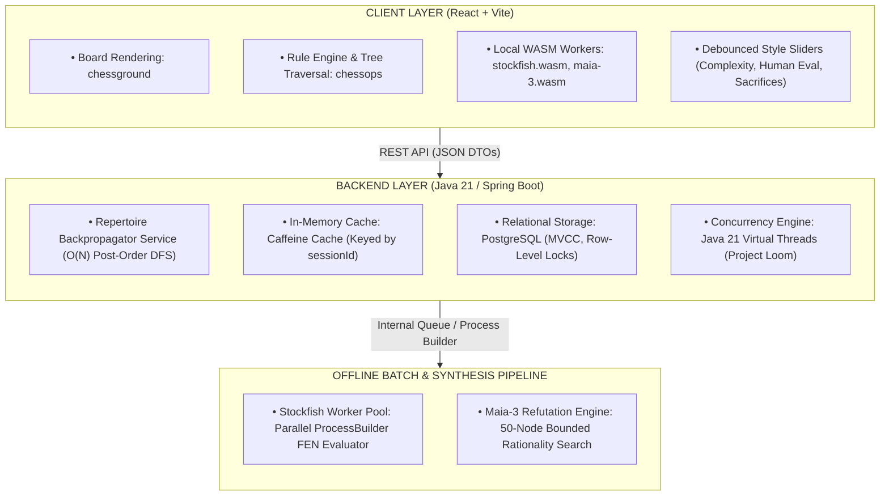
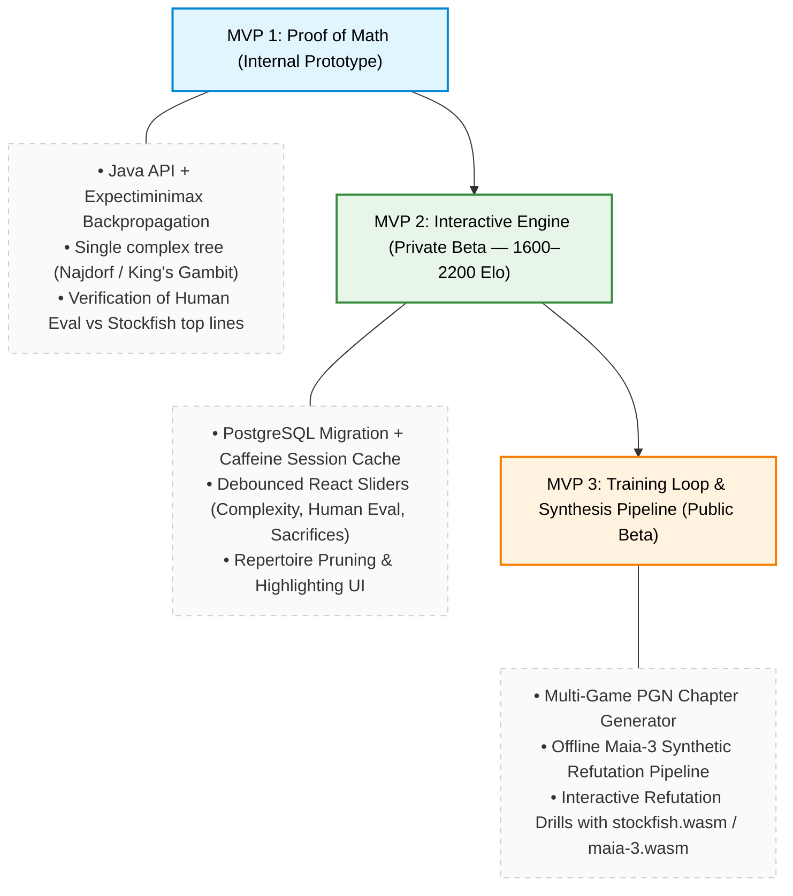

# CONTEXT.md — PrepChess Master System Architecture & Product Spec

**Related Documents:**
*   [Product Vision & Brand (Taylor Mascot)](VISION.md)
*   [Market Strategy & Business Proposition](market/README-MARKET.md)

---

## 1. Executive Summary & Core Philosophy

**PrepChess** is an adaptive, algorithmic chess opening repertoire generator and interactive study platform. Traditional engines (e.g., Stockfish) rely on standard Minimax search to identify the single "objectively best" move, assuming 100% perfect play from opponents. This frequently produces "tightrope" lines—positions where Stockfish evaluates an edge at 0.00 or +0.30, but a single human inaccuracy leads to immediate collapse.

PrepChess introduces the **"Practical Human Eval"** framework:
1. **Minefields vs. Tightropes:** PrepChess identifies lines where human opponents are statistically prone to errors, maximizing practical winning chances over theoretical engine perfection.
2. **Multi-Objective Utility Backpropagation:** Instead of pure centipawn scores, candidate branches are evaluated using a custom utility function U(n) combining mean engine evaluation (μ), move volatility/sharpness (σ), sacrifice metrics, and human move frequency P(move).
3. **Hollow Frontend Security:** All proprietary scoring math, backpropagation heuristics, and repertoire pruning logic execute strictly on the Java backend, keeping client code an un-copyable rendering shell.

---

## 2. Mathematical Engine & Algorithmic Specifications

### 2.1 Leaf Node Composite Score
For every terminal leaf node *n* at depth *D* (up to move 25), the utility U(n) is calculated via user-controlled slider weights *w*:

U(n) = (w_μ * μ(n)) + (w_σ * σ(n)) + (w_sac_player * Sac_player(n)) - (w_sac_opp * Sac_opp(n))

Where:
* **μ(n) (Human/Engine Eval):** Normalized average engine evaluation across candidate moves from node *n* (capped between -3.0 and +3.0).
* **σ(n) (Volatility / Complexity):** Standard deviation of evaluations across legal moves flowing out of node *n*. High σ indicates tactical "minefields" where one mistake leads to a severe score drop.
* **Sac_player(n) & Sac_opp(n):** Continuous indicators (0.0 to 1.0) measuring material imbalance relative to starting material (tactical initiative vs. material sacrifice).

### 2.2 Expectiminimax Backpropagation Model
Tree evaluation flows bottom-up via Post-Order Depth-First Search (DFS):

```text
               ┌─────────────────────────────────────────┐
               │              Player Node                │
               │   U(v) = MAX [ U(child_1), U(child_2) ] │
               └────────────────────┬────────────────────┘
                                    │
                                    ▼
               ┌─────────────────────────────────────────┐
               │             Opponent Node               │
               │   U(v) = ∑ P(move_i) * U(child_i)       │
               └─────────────────────────────────────────┘

```

1. **Player Nodes (MAX Decision):**
U(v) = max( U(child(v, a)) ) across all legal moves *a*.
2. **Opponent Nodes (Expectation Decision):**
U(v) = ∑ [ P(a | v) * U(child(v, a)) ] across all opponent moves *a*.

Where P(a | v) = (Games played with move *a*) / (Total games in position *v*) based on database frequency filtering (≥ 20 games).

---

## 3. System Architecture & Component Responsibilities

PrepChess follows the **Thin Client ("Hollow Frontend") Architecture**:



### 3.1 Security & IP Isolation

* **Proprietary Isolation:** The utility function U(n), leaf metrics (μ, σ), and probability tables P(a | v) remain strictly on the Java backend.
* **Sanitized API Payloads:** Network responses return only boolean flags and presentation labels (e.g., `{"recommended": true, "badge": "High Sharpness"}`), preventing reverse-engineering of scoring coefficients.
* **Rate Limiting:** API requests are throttled (Bucket4j + Redis) to 30 recalculations/minute per user to prevent data scraping.

---

## 4. Database Schema & Memory Optimization

### 4.1 Production Database: PostgreSQL

Migrated from H2 to PostgreSQL to support multi-instance scaling, MVCC row-level concurrency, and batch writing optimizations (`reWriteBatchedInserts=true`).

```sql
CREATE SEQUENCE repertoire_node_seq START WITH 1 INCREMENT BY 500;

CREATE TABLE repertoire_nodes (
    id BIGINT PRIMARY KEY DEFAULT nextval('repertoire_node_seq'),
    session_id UUID NOT NULL,
    parent_id BIGINT REFERENCES repertoire_nodes(id) ON DELETE CASCADE,
    move_san VARCHAR(10) NOT NULL,
    fen VARCHAR(100) NOT NULL,
    mean_eval REAL NOT NULL,
    std_dev_eval REAL NOT NULL,
    player_sac REAL DEFAULT 0.0,
    opp_sac REAL DEFAULT 0.0,
    opp_play_prob REAL DEFAULT 0.0,
    node_type VARCHAR(20) DEFAULT 'MAINLINE', -- MAINLINE, MISTAKE_EXAMPLE, REFUTATION
    target_mistake_san VARCHAR(10),
    is_synthetic BOOLEAN DEFAULT FALSE,
    CONSTRAINT fk_session FOREIGN KEY (session_id) REFERENCES repertoire_sessions(id)
);

CREATE INDEX idx_nodes_session_id ON repertoire_nodes(session_id);
CREATE INDEX idx_nodes_parent_id ON repertoire_nodes(parent_id);

```

### 4.2 In-Memory Performance & Caching Strategy

* **RAM Footprint:** 50,000 DTO node objects occupy ~7.5 MB to 10 MB of JVM Heap.
* **Caffeine Cache:** Holds active session trees in memory (`expireAfterAccess(15, TimeUnit.MINUTES)`). Slider tweaks pull directly from RAM, bypassing DB reads and completing backpropagation in <15ms.
* **O(N) Reconstruction:** Uses a single-pass `HashMap<Long, RepertoireNode>` to connect parents to children in <10ms.
* **Entity Sequence Allocation:** Sets JPA `@SequenceGenerator(allocationSize = 500)` to prevent Hibernate from disabling batch operations.

---

## 5. Repertoire Structuring & Refutation Pipelines

### 5.1 Repertoire Tree Distribution

* **Mainline & Sidelines (≥ 20 Games):** Ingested from Lichess/Master databases up to move 25.
* **Error / Blunder Branches:** Account for **15–20% of the total tree size** (e.g., +9,000 nodes on a 50,000-node tree).
* **Sparse Data Handling (1-Game Blunders):** When empirical game data lacks defensive continuations, the backend offline pipeline runs a modified **Maia-3 50-node Bounded Rationality Search** to synthesize realistic human defense lines and their punishments.

### 5.2 Multi-Game PGN Chapter Schema

Studies are structured into distinct chapters:

* **`Mainline`:** Core recommended paths based on slider preferences.
* **`Mistake` / `Error Example`:** Critical positions where the user or opponent commits common blunders.
* **`Refutation`:** Tactical continuations punishing human errors.

---

## 6. Neuroscience-Backed Training Methodology

1. **Prediction Error-Driven Learning:** The UI hides blunder continuations initially, prompting the user: *"Predict the opponent's common mistake here"* before showing the refutation.
2. **Contrastive Visual Encoding:** Side-by-side rendering comparing the **Book Move** vs. the **Blunder/Refutation**.
3. **Interleaved Active Recall:** Training decks mix Defensive Awareness ("Avoid the pitfall") and Offensive Refutation ("Punish the mistake") using an SM-2 / Leitner Spaced Repetition engine.

---

## 7. Product Development Roadmap



---

## 8. Development & Design Workspace Management

To preserve LLM context windows during development:

* **Master Ledger:** Maintain `prepchess-design/CONTEXT.md` as the single source of truth.
* **Decision Tracking:** Append architectural changes to `DECISION_LOG.md`.
* **Feature Specs:** Draft detailed task requirements in `specs/SPEC-XX.md`.
* **Execution Workflow:** Reference `@CONTEXT.md` in fresh Antigravity IDE chats, execute tasks via `agy` CLI, and clear context (`/clear`) between features.


